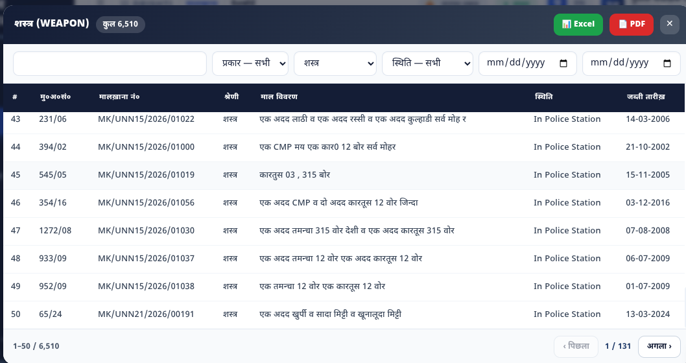
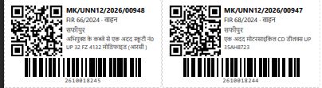

## new features to be added

- add a lincencse shastra entry form in the add mlkhna page., with these field ( the licence form shold be when the dropdown has the Licacned shastra)
  रसीद नं
  थाना
  लाइसेंस नं.
  मालिक का नाम
  पता
  मोबाइल
  हथियार
  हथियार नं.
  जमा तिथि
  कारण
  रैक

- add categories of the maal
  
  after clicking on any cateogory it should open the modal with the maal of that categpry
   : give the option to export them in the excel/ pdf form
- in repot section user can generate the barcode improve the barcode by adding more features such as qrcode , details , and barcode
  

### to be tested or improve bugs

- check if release ,movement, destroy,
